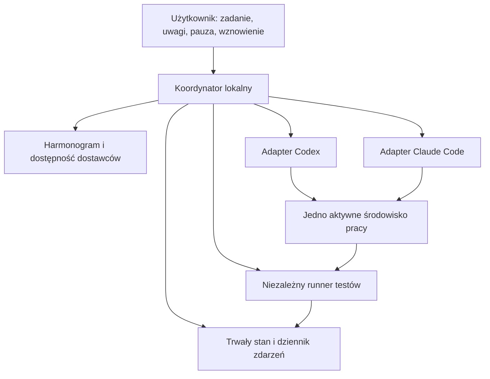

# ProjectGemini — koncepcja naprzemiennej współpracy Codex i Claude Code

Stan rozpoznania: 1 listopada 2026. Dokument opisuje pierwotną koncepcję. Działający system opisuje README.md; zbudowano go jako przebudowę Duet w Pythonie, z interfejsem WWW zamiast panelu terminalowego. Nazwa ProjectGemini oznacza tu parę współpracujących agentów, bez wymogu użycia modeli Google Gemini.

## 1. Cel i rekomendacja

Użytkownik podaje zadanie i kryteria odbioru. Claude Code i Codex kolejno analizują projekt, realizują zmiany, sprawdzają pracę poprzednika i przekazują sobie stan. Użytkownik może zatrzymać proces, zmienić wymagania i wznowić go. Niedostępność jednego dostawcy nie powinna blokować pracy drugiego.

Rekomenduję **lokalny koordynator niezależny od obu modeli**, dwa adaptery do oficjalnych narzędzi dostawców oraz trwały, wspólny zapis zadania. Koordynator jest zwykłym programem: nie wymaga własnego modelu ani dodatkowego abonamentu. Kieruje kolejką, kontroluje procesy, zapisuje stan, uruchamia testy i rozstrzyga, kto może edytować projekt. Agenci podejmują decyzje programistyczne.

Przyjmuję tekstowy panel terminalowy jako pierwszy interfejs. Dokumentacja, przekazania i wyniki pozostają czytelne również bez działającego panelu. Dalsza nakładka graficzna korzystałaby z tego samego koordynatora.

## 2. Rozpoznanie istniejących rozwiązań

Poniżej porównano publiczną dokumentację autorów. Nie instalowano ani nie testowano tych projektów lokalnie; deklaracje README nie są potwierdzeniem niezawodności.

| Rozwiązanie | Co już oferuje | Przydatność i ograniczenie względem naszego celu |
|---|---|---|
| **agentproto CLI** | Przekazanie Claude Code → Codex z checkpointem; zdarzenie sugerujące przekazanie po limicie | Najbliższy wzorzec transferu kontekstu. Dokumentacja mówi, że źródłowa sesja pozostaje uruchomiona; nie zapewnia więc sama wyłączności edycji. Sugestia po limicie nie oznacza kompletnej automatycznej polityki przełączeń. |
| **agtx** | Wspólna tablica zadań, wielu agentów, zmiana agenta pomiędzy fazami, przekazanie kontekstu | Najbliższy kandydat do adaptacji gotowego środowiska. Trzeba sprawdzić zachowanie limitów, zatrzymania i naszego warunku wspólnego odbioru. Opiera sesje na tmux. |
| **Claude–Codex Orchestrator Plugin** | Claude planuje i nadzoruje Codex, zapisywane są prompty i przekazania | Dobre wzorce recenzji i śledzenia pracy. Układ jest asymetryczny: Claude pozostaje koordynatorem, co nie odpowiada wymaganiu niezależnego działania po jego limicie. |
| **LangGraph** | Trwały stan, checkpointy, przerwania i wznowienie po interwencji człowieka | Może być fundamentem maszyny stanów. Sam nie dostarcza gotowej integracji abonamentów i obu narzędzi programistycznych. Dla pierwszej wersji może być większy niż potrzebujemy. |

Źródła: [agentproto — przekazanie i limity](https://cli.agentproto.sh/docs/guides/handoff), [agtx — repozytorium autorów](https://github.com/fynnfluegge/agtx), [Claude–Codex Orchestrator](https://github.com/alexzh3/codex-orchestrator), [LangGraph — trwały stan](https://docs.langchain.com/oss/python/langgraph/persistence), [LangGraph — interwencja użytkownika](https://docs.langchain.com/oss/python/langgraph/interrupts).

**Wniosek projektowy:** mechanizmy potrzebne do tego eksperymentu już istnieją. Z przejrzanych materiałów nie wynika jednak, że któryś produkt realizuje cały nasz kontrakt: symetryczna współpraca, pewne zatrzymanie poprzednika, kontrola abonamentów, kontynuacja przy jednym dostępnym agencie i wspólny odbiór tego samego wyniku. Przed wyborem gotowej bazy warto porównać agtx i agentproto na krótkim teście integracyjnym. Nie zalecam instalowania kilku rozbudowanych orkiestratorów naraz.

## 3. Architektura

Pierwsza wersja: jeden koordynator i jeden agent edytujący naraz. Nie ma potrzeby uruchamiania kilku agentów równolegle. Projekt jest wspólny, lecz prawo wykonywania zmian przechodzi kolejno między nimi.

Proponowany fundament techniczny: TypeScript/Node.js, SQLite jako źródło stanu i tekstowy panel. To decyzja projektowa do oceny, nie wymóg dostawców. SQLite przechowuje zadania, próby, rewizje poleceń użytkownika, dostępność providerów i wyniki testów. Obszerne logi trafiają do plików. Markdown stanowi czytelny eksport, a nie drugą niezależną bazę stanu.

Koordynator powinien zarządzać repozytorium Git i jednym roboczym worktree dla aktywnej linii zadania. Stan operacyjny należy trzymać poza drzewem edytowanym przez agentów. Zmiany samego koordynatora są zwykłym zadaniem projektowym i nie zmieniają reguł działającej instancji w trakcie cyklu.

## 4. Oficjalne integracje

### Codex

Docelowy adapter korzysta z `codex app-server`. Udokumentowane są sesje, strumień zdarzeń, przerwanie tury oraz odczyt i aktualizacje limitów konta ChatGPT. Prostszym wariantem pilota jest `codex exec` ze zdarzeniami JSON. Wersja lokalna rozpoznana w tej sesji: `codex-cli 0.166.0`.

Nie zakładamy sterowania istniejącym oknem desktopowym ani przeniesienia całej jego pamięci do nowej sesji. Aplikacja prowadzi własne sesje i przekazuje im wspólny stan projektu. Obsługiwane metody trzeba sprawdzić dla zainstalowanej wersji przed implementacją adaptera. [Codex App Server](https://learn.chatgpt.com/docs/app-server), [tryb nieinteraktywny](https://learn.chatgpt.com/docs/non-interactive-mode).

### Claude Code

Punktem wyjścia jest oficjalny tryb `claude -p`, strumieniowe wyjście i jawne identyfikatory wznawianych sesji. Pozwala zachować narzędzia Claude Code zamiast zastępować je własnym klientem modeli. W tej sesji polecenie `claude` nie było widoczne w PATH; nie dowodzi to braku instalacji w środowisku użytkownika. Rozpoznanie ścieżki, wersji i logowania będzie pierwszą kontrolą integracyjną.

Nie zakładać, że dowolny Agent SDK korzysta z abonamentu identycznie jak CLI. Oficjalny tryb `--bare` pomija logowanie abonamentowe; nie wybieramy go domyślnie dla tego eksperymentu. [Claude Code — uruchamianie programowe](https://code.claude.com/docs/en/headless).

Adaptery powinny mieć wspólny kontrakt: start, wznowienie, strumień zdarzeń, prośba o przerwanie, potwierdzenie zakończenia, dostępność, zużycie i możliwości danej wersji. Nieznane dodatkowe zdarzenie należy zachować w logu; uszkodzony lub niejednoznaczny strumień nie może zostać uznany za poprawne przekazanie.

## 5. Cykl współpracy

1. Użytkownik definiuje cel, zakres, ograniczenia i kryteria odbioru. Koordynator zapisuje wersję polecenia.
2. Pierwszy agent otrzymuje zadanie, aktualny kod i stan testów. Wykonuje mały, spójny zakres pracy.
3. Koordynator odbiera raport, potwierdza zakończenie procesów zapisujących pliki, zapisuje checkpoint i wykonuje uzgodnione kontrole.
4. Drugi agent najpierw sprawdza fakty: diff, kod, wyniki i zgodność z wymaganiami. Następnie może poprawiać wykazane problemy lub realizować kolejny uzgodniony krok.
5. Nowe zmiany tworzą kolejną wersję i unieważniają wcześniejszą akceptację. Wynik wraca do partnera.
6. Gdy recenzent nie ma uwag wymagających zmiany kodu, zapisuje akceptację konkretnej wersji. Drugi agent również ocenia tę samą wersję.

Rola autora i recenzenta przechodzi między modelami. Nie przypisujemy jednemu dostawcy stałej nadrzędności. Raport poprzednika jest wskazówką do weryfikacji, a nie dowodem poprawności.

Jedna tura ma kończyć się spójnym rezultatem lub czytelnym checkpointem. Dla pilota można przyjąć orientacyjnie 10–20 minut pracy na turę, z osobnym czasem dla długich testów. Czas nie powinien powodować brutalnego przerwania poprawnego zapisu pliku; twardy timeout służy wykrywaniu zawieszenia.

## 6. Pakiet przekazania

Każde przekazanie zawiera:

| Pole | Znaczenie |
|---|---|
| Zadanie i rewizja wymagań | Co jest aktualnym poleceniem użytkownika |
| Wersja kodu | Commit/checkpoint, stan worktree i ewentualne niezapisane zmiany |
| Wykonany zakres | Konkretne zachowanie przed i po zmianie |
| Uzasadnienie | Dlaczego wybrano dane rozwiązanie |
| Testy | Polecenie, wersja kodu i danych, wynik, czas oraz ścieżka do logu |
| Problemy | Otwarte usterki z dowodem lub sposobem odtworzenia |
| Następny krok | Najmniejsza sensowna czynność do wykonania |
| Status | Kontynuacja, kandydat do odbioru, brak zasobów albo potrzebna decyzja |
| Przyczyna zakończenia | Normalne przekazanie, limit, pauza, błąd lub przerwanie |

Pliki przekazania są wersjonowane; nie nadpisujemy jednego `handoff.md` bez historii. Pełne transkrypcje pozostają dostępne, ale następny agent dostaje zwięzły stan, diff i istotne wyniki. Wznowienie natywnej sesji nie zwalnia go z przeczytania nowych uwag użytkownika i zmian partnera.

**Nagły limit:** nie można zakładać, że agent zdąży napisać podsumowanie po zablokowaniu modelu. Koordynator sam zapisuje stan Git, diff, ostatnie zdarzenia i procesy. Oznacza przekazanie jako niepełne. Następca zaczyna od rekonstrukcji stanu; nie traktuje częściowo zapisanej pracy jako ukończonej.

## 7. Limity i ciągłość pracy

Koordynator rozróżnia limit abonamentowy, chwilowe ograniczenie szybkości, awarię usługi, problem z logowaniem, limit kontekstu oraz lokalny budżet zadania. Nie każdy błąd 429 uzasadnia wielogodzinne odłożenie providera.

Dla każdego dostawcy zapisuje: dostępny / zbliża się do limitu / wstrzymany do wskazanego czasu / wymaga logowania / stan nieznany. Odczyt zawiera źródło i czas aktualizacji. Nieznany stan nie jest prezentowany jako „100% dostępne”. Liczba tokenów nie pozwala wiarygodnie wyliczyć pozostałego abonamentu.

Codex udostępnia odczyt limitów i powiadomienia przez app-server. W Claude dokumentacja statusline opisuje procenty okien i czasy resetu, ale pola mogą być nieobecne. Nie oznacza to automatycznie identycznej telemetrii w każdym trybie nieinteraktywnym. Adapter powinien rozpoznawać faktycznie dostępne zdarzenia limitu; brak procentów nie blokuje reakcji na potwierdzoną odmowę. [Codex — limity](https://learn.chatgpt.com/docs/app-server), [Claude — pola zużycia](https://code.claude.com/docs/en/statusline).

**Polityka domyślna:**

- Gdy obaj są dostępni, praca przechodzi naprzemiennie po spójnym kroku.
- Gdy pierwszy osiąga limit, drugi przejmuje po zatrzymaniu poprzednika i zapisaniu stanu.
- Gdy partner nadal jest niedostępny, aktywny agent może wykonywać kolejne kroki i własne kontrole. Wynik ma status „oczekuje na niezależny przegląd”. Nie udajemy, że odbyła się recenzja drugiego modelu.
- Gdy partner wróci, dostaje skumulowany diff i aktualne wymagania. Nie odbiera pracy w połowie bezpiecznego kroku tylko dlatego, że nastąpił reset limitu.
- Gdy obaj są niedostępni, zadanie trwa w stanie oczekiwania. Koordynator nie musi zużywać modelu, aby poczekać do resetu.
- Przy nieznanym resecie ponowienia są rzadkie i mają rosnący odstęp. Nie prowadzimy pętli ciągłych prób.

Użytkownik ustawia budżet czasu, rezerwę wykorzystania i zgodę na wznowienie po resecie. Opcjonalny tryb „wykorzystaj dostępny abonament” pozwala pracować do limitu, jeżeli istnieją zadania do wykonania. Osiągnięty cel kończy pracę wcześniej.

Nie przełączamy automatycznie na płatne API, dodatkowe kredyty ani inne konta. Przed startem adapter potwierdza sposób rozliczania. Obecność klucza API może zmienić wybrane uwierzytelnienie Claude Code; wymaga to świadomego wyboru profilu uruchomienia. [Claude — uwierzytelnienie i pierwszeństwo poświadczeń](https://code.claude.com/docs/en/authentication).

Zużycie w innych czatach i narzędziach może zmienić limit w trakcie tury. Rezerwa zmniejsza ryzyko przerwania, ale go nie usuwa.

## 8. Kontrola użytkownika

Proponowane polecenia tekstowe — nazwy koncepcyjne, jeszcze niezaimplementowane:

| Polecenie | Działanie |
|---|---|
| `status` | Cel, aktywny agent, etap, testy, dostępność i ostatni checkpoint |
| `pause` | Natychmiast blokuje kolejne tury; przerywa aktywnego agenta i doprowadza proces do kontrolowanego postoju |
| `stop-now` | Awaryjnie zatrzymuje zarządzane procesy, zachowuje częściowy stan i wymaga kontroli przed wznowieniem |
| `note ...` | Zapisuje uwagę bez zmieniania jej w ukryte automatyczne wznowienie |
| `revise ...` | Wprowadza nową rewizję wymagań; domyślnie z pauzą |
| `resume` | Wznawia według najnowszych wymagań |
| `handoff codex/claude` | Przekazuje po osiągnięciu bezpiecznej granicy |
| `diff`, `tests`, `history` | Pokazuje rzeczywiste zmiany, dowody i historię przekazań |

Komenda użytkownika ma pierwszeństwo przed przekazaniem i automatycznym wznowieniem po limicie. Aktywna pauza nigdy nie znika wskutek resetu abonamentu.

Przy pauzie panel rozróżnia „zatrzymywanie” i „zatrzymano”. Potwierdzenie pauzy oznacza brak zarządzanych procesów mogących zmieniać projekt. Jeśli jakiś proces zewnętrzny nadal działa, panel pokazuje ten fakt i nie uruchamia partnera. Przerwanie nie cofa już wykonanych operacji; checkpoint zachowuje ich stan.

Użytkownik może dopisać uwagę podczas pracy. Pilna uwaga zatrzymuje proces; zwykła trafia do następnej tury. Następca potwierdza, którą rewizję odczytał. Zmiana wymagań unieważnia wcześniejsze odbiory, a nie usuwa historii.

## 9. Wspólne pliki i odporność na awarie

Reguła nadrzędna: **przekazanie kończy się dopiero po potwierdzeniu, że poprzednik utracił możliwość zapisu do aktywnego środowiska**. Sam komunikat „skończyłem” i wygaśnięcie czasowej blokady nie wystarczają. Koordynator śledzi proces agenta i jego zadania potomne; odłączone polecenia trzeba zabronić albo jawnie rejestrować.

Blokada programu chroni współpracujące instancje, lecz nie powstrzyma ręcznie uruchomionego Claude lub edytora z pełnym dostępem. Dlatego worktree powinno być przeznaczone wyłącznie dla koordynatora. Wykrycie nieoczekiwanych zmian wstrzymuje przekazanie i zachowuje oba stany do oceny.

Każda próba i każde polecenie mają identyfikator. Po restarcie koordynator najpierw sprawdza istniejące procesy i stan roboczy. Nie uruchamia automatycznie drugiej kopii tego samego zadania. Baza i logi są zapisywane trwale; przekazanie jest zatwierdzane transakcyjnie. Nie deklarujemy automatycznej gwarancji „dokładnie raz” dla zewnętrznych operacji, takich jak publikacja lub migracja bazy.

Zwykłe edycje i lokalne kontrole mieszczą się w upoważnieniu do zadania. Publikacja, operacje nieodwracalne lub rozszerzenie zakresu wymagają odpowiedniego upoważnienia użytkownika. Panel nie powinien pytać o zgodę na każdą poprawkę.

## 10. Testy i warunek zakończenia

Zgoda obu modeli sama nie dowodzi poprawności. Koordynator wykonuje kontrolne polecenia ustalone dla projektu i przypisuje wyniki do konkretnego commitu, wersji wymagań oraz danych. Nie musi powtarzać kosztownego testu, gdy kod i istotne wejścia pozostały identyczne.

Agent zaczyna od sprawdzenia poprzedniej zmiany i ryzyk. Wykonana poprawka musi wynikać z wymagania, dowodu błędu lub istotnej luki w pokryciu. Nie wymuszamy nowych testów dla każdej drobnej, odwracalnej zmiany. Nie zaliczamy osłabienia kryterium testu jako naprawienia aplikacji.

Warunek odbioru zadania:

1. Aktualne kryteria użytkownika są spełnione i mają dowody.
2. Wymagane kontrole przeszły dla końcowej wersji; niewykonane kontrole są jawne.
3. Nie ma otwartych usterek blokujących odbiór.
4. Codex i Claude niezależnie zaakceptowali **ten sam commit i tę samą rewizję wymagań**, bez późniejszych zmian.

Gdy drugi agent jest niedostępny, możliwy jest status „gotowe, oczekuje na partnera”, lecz nie pełny wspólny odbiór. Użytkownik może świadomie przyjąć wynik wcześniej.

Nie uruchamiamy niekończącego się udoskonalania stylistyki. Opcjonalne pomysły trafiają do backlogu. Ten sam problem otrzymuje trwały identyfikator i sposób odtworzenia. Spór rozstrzyga wymaganie lub eksperyment, nie liczba głosów.

Proponowana ochrona pilota: po trzech pełnych cyklach bez mierzalnego postępu zatrzymać automatyczne zmiany, zachować najlepszą wersję i przedstawić spór. Nie jest to limit liczby wartościowych iteracji. Osiągnięcie budżetu zadania również prowadzi do checkpointu, a nie deklaracji ukończenia.

## 11. Reguły tekstowe przekazywane obu agentom

Poniższy tekst może później stać się wspólnym kontraktem, do którego odsyłają AGENTS.md i CLAUDE.md:

> Pracujesz wspólnie z drugim agentem nad celem użytkownika. Obowiązują najnowsza rewizja wymagań i przydzielony zakres. Przeczytaj checkpoint, diff i dowody poprzednika. Sprawdź je samodzielnie. Wprowadzaj zmiany uzasadnione wymaganiami i wynikami kontroli. Nie odwracaj decyzji partnera wyłącznie z powodu preferencji stylistycznej. Opisz problem i dowód, jeżeli się nie zgadzasz.
>
> Nie uruchamiaj partnera samodzielnie; przekazaniem i prawem zapisu zarządza koordynator. Nie zmieniaj jego stanu, budżetów ani wymagań użytkownika. Nie ukrywaj nieudanych lub niewykonanych kontroli. Nie zmieniaj sposobu rozliczania. Przy końcu tury zapisz wykonany zakres, wersję kodu, testy, otwarte problemy i następny krok. Możesz zakończyć recenzję bez zmiany kodu. Wskaż, czy akceptujesz dokładnie tę wersję, czy potrzebujesz dalszej pracy.
>
> Po wznowieniu sesji ponownie sprawdź polecenia użytkownika i zmiany partnera. Wcześniejsza pamięć rozmowy nie ma pierwszeństwa przed aktualnym stanem zadania.

## 12. Zakres pierwszego prototypu i kryteria eksperymentu

Po zatwierdzeniu koncepcji pierwszy prototyp powinien obejmować jeden projekt, jedno zadanie, dwóch adapterów, jeden aktywny worktree, przekazania, panel tekstowy, pauzę/wznowienie i trwałą historię. Bez roju agentów, chmury i automatycznej publikacji.

Najpierw należy przetestować sam mechanizm na małym zadaniu demonstracyjnym. Wyczerpanie abonamentu symulować w adapterze; nie zużywać celowo kont do zera.

| Próba | Oczekiwany dowód |
|---|---|
| Claude zmienia, Codex znajduje błąd i poprawia | Kolejny checkpoint i kontrola poprawki przez Claude |
| Recenzent nie znajduje usterek | Akceptacja bez sztucznej zmiany kodu |
| Limit w środku edycji | Zachowany częściowy stan, następca rozpoczyna od weryfikacji |
| Jeden provider długo niedostępny | Drugi realizuje kolejne kroki, odbiór nadal czeka na partnera |
| Obaj niedostępni | Oczekiwanie bez lawiny ponowień i bez płatnego fallbacku |
| Pauza podczas zapisu lub testu | Brak startu partnera do potwierdzonego zatrzymania |
| Zmiana celu w pauzie | Nowa rewizja widoczna przy wznowieniu, stare akceptacje nieważne |
| Restart koordynatora | Brak podwójnego workera i zachowana historia |
| Model twierdzi, że test przeszedł, a log temu przeczy | Raport nie otrzymuje akceptacji |
| Agenci cyklicznie odwracają rozwiązanie | Wykrycie braku postępu, zachowany wynik i opis sporu |

Wynik eksperymentu mierzyć przez wykonane kryteria, rzeczywiste błędy wykryte przez partnera, liczbę bezcelowych zmian, czas, zużycie i skuteczność odzyskania po przerwaniu. Nie przez samą liczbę przekazań.

**Rekomendowana decyzja:** przyjąć opisany kontrakt jako specyfikację ProjectGemini. Następnie wykonać mały test możliwości oficjalnych adapterów i porównanie agtx/agentproto. Dopiero na tej podstawie zdecydować, czy adaptować istniejącą bazę, czy napisać niewielki własny koordynator. Decyzja zapadła 1 listopada 2026: bazą został Duet.
