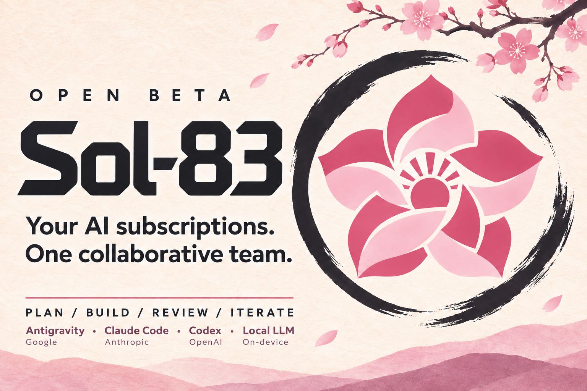
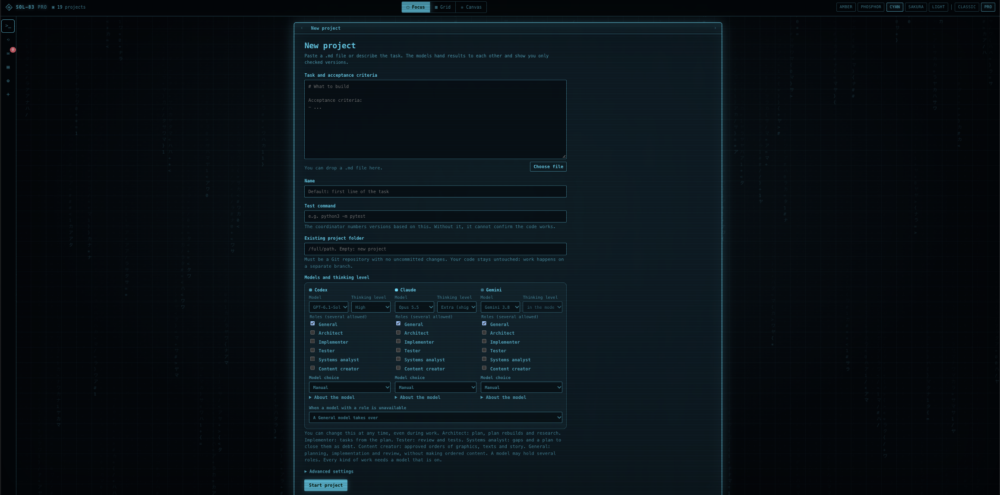
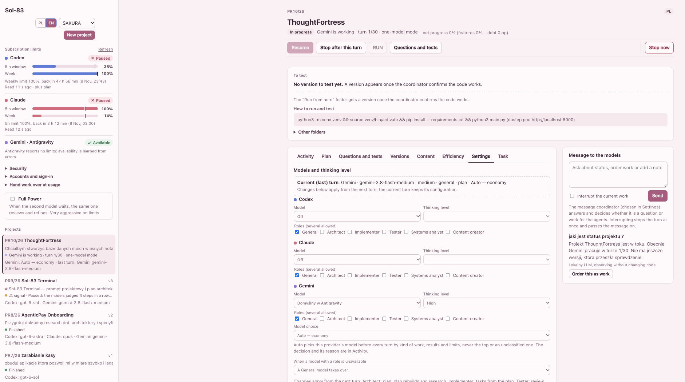
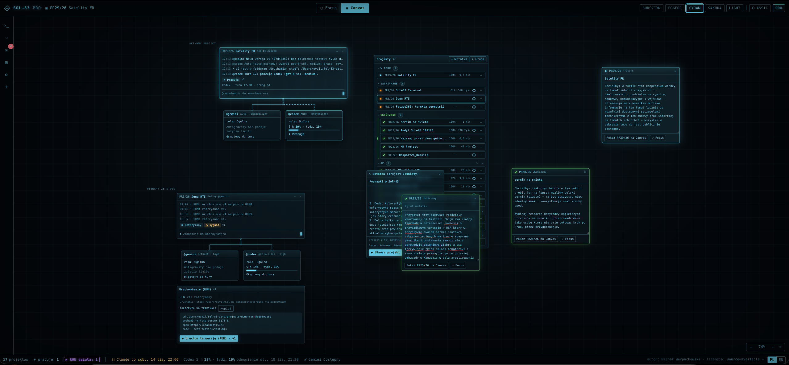
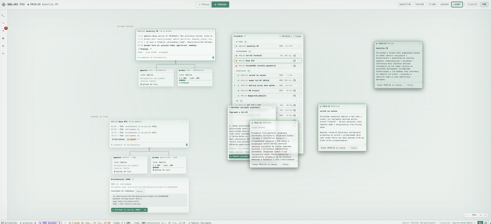
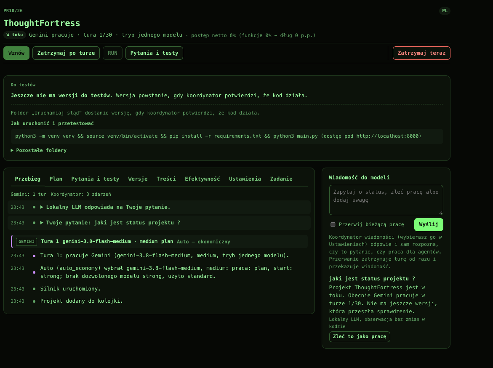
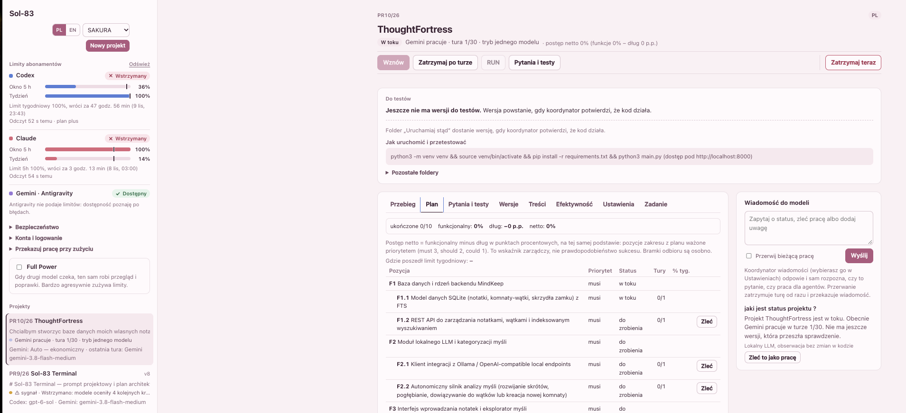

<p align="center">
  
</p>

<p align="center">
  <b>Your AI subscriptions. One collaborative team.</b><br>
  Claude Code · Codex · Gemini (Antigravity) · local LLM
</p>

<p align="center">
  <a href="README.md">Polski</a> ·
  <a href="docs/en/INSTALL.md">Install</a> ·
  <a href="docs/en/GUIDE.md">Guide</a> ·
  <a href="#screenshots">Screenshots</a> ·
  <a href="#coffee">Buy me a coffee ☕</a>
</p>

# Sol-83 (OpenBeta)

Sol-83 is a local coordinator that makes coding agents take turns on one repository: **Claude Code**, **Codex** and optionally **Gemini through Antigravity**. They check each other, and when one runs out of subscription limit the other takes over. The coordinator is a plain program, not a model: it saves a Git checkpoint after every turn, runs the tests in a sandbox and numbers a version only when they pass. You get checked versions, questions only when they are really needed, and a web panel on `127.0.0.1:8765` in Polish and English.

Subscriptions only: no API keys, no paid extra usage.

> **Status:** OpenBeta, developed since November 2026. Tested on macOS (Apple Silicon). Linux is supported in the code but untested on real hardware; Windows is not supported. The status of every feature, with tests and limits: [docs/TRACEABILITY.md](docs/TRACEABILITY.md) (Polish).

<a id="screenshots"></a>
## What it looks like

The panel has **two looks with the same functions**, switched with the **CLASSIC / PRO** button (the choice is remembered in the browser):

- **Classic** (`http://127.0.0.1:8765/`): the project list on the side and the project details, skins LIGHT, DARK, SAKURA, TERMINAL.
- **Pro** (`http://127.0.0.1:8765/pro`): a futuristic terminal with translucent windows. **Focus** (one project with every Classic function), **Grid** (project tiles) and **Canvas** (windows you drag and zoom, with the project's model windows joined by lines that animate while the model works). A project window shows who leads the work ("led by @claude"), the latest events and the state, and the **❯** field sends a message to the coordinator. Notifications in the top right corner (questions and tests with answer buttons, a limit pause with "Try now", a setup script to approve), a status bar with limits and reset dates, palettes AMBER, PHOSPHOR, CYAN, SAKURA, LIGHT, scan lines and background glyphs with a switch (off with reduced motion). Details: [guide, section 16](docs/en/GUIDE.md#16-panel-looks-classic-and-pro).

<p align="center">
  <br>
  <sub>Pro, Focus view (CYAN palette): a new project with models, thinking level and roles, the same functions as in Classic.</sub>
</p>

**Classic:**

<p align="center">
  <br>
  <sub>The SAKURA skin in English: subscription limits, project cards, models with several roles and Auto mode.</sub>
</p>

<table>
  <tr>
    <td width="50%" align="center" valign="top">
      <br>
      <sub>The plan with priorities, turn budgets and an "Order" button on every item (Polish interface).</sub>
    </td>
    <td width="50%" align="center" valign="top">
      <br>
      <sub>Settings: the current turn's snapshot, several roles per model, Auto mode (Polish interface).</sub>
    </td>
  </tr>
</table>

<details>
  <summary><b>More screenshots</b></summary>
  <p align="center">
    <br>
    <sub>Activity: clear turn headers (executor, model, kind of work) and an answer from the local coordinator.</sub>
  </p>
  <p align="center">
    <br>
    <sub>The project view with net progress in the plan (Polish interface).</sub>
  </p>
</details>

## Quick start

Full installation from scratch, step by step: **[docs/en/INSTALL.md](docs/en/INSTALL.md)**.

```bash
git clone https://github.com/MikeMcqueen83/Sol-83-OpenBeta.git
```

```bash
cd Sol-83-OpenBeta && ./bin/setup && ./sol83 doctor
```

```bash
./sol83 serve
```

Open http://127.0.0.1:8765 and click **New project**.

## Documentation

[Install](docs/en/INSTALL.md) · [Guide](docs/en/GUIDE.md) (including the Classic and Pro looks) · [Data, backups, updates, rollback](docs/en/UPDATES.md) · [Security](SECURITY.md) · [Contributing](CONTRIBUTING.md) · [Changelog](CHANGELOG.md)

<a id="coffee"></a>
## ☕ Buy me a coffee

I develop Sol-83 on my own and share it free for non-commercial use. If it saved you time or subscription limits, if you like the idea, or you would simply like new features to land sooner, you can buy me a coffee. It genuinely helps keep the project going, and every bit of support is hugely motivating. Thank you! 🌸

<p align="center">
  <a href="https://buycoffee.to/evvil" target="_blank"></a>
</p>

## License

Sol-83 is **source-available**, not OSI open source: non-commercial use by individuals is allowed; any commercial use, including use by companies (internal too) and putting the code or any part of it into monetized products or services, needs the author's prior written consent; contributions go through forks or branches. The terms are a draft pending legal review: [LICENSE.md](LICENSE.md). Duet and other components keep their own licenses: [THIRD_PARTY_NOTICES.md](THIRD_PARTY_NOTICES.md). Projects you create with Sol-83 get the license you choose.

Author: Michał Werpachowski.
