<p align="center">
  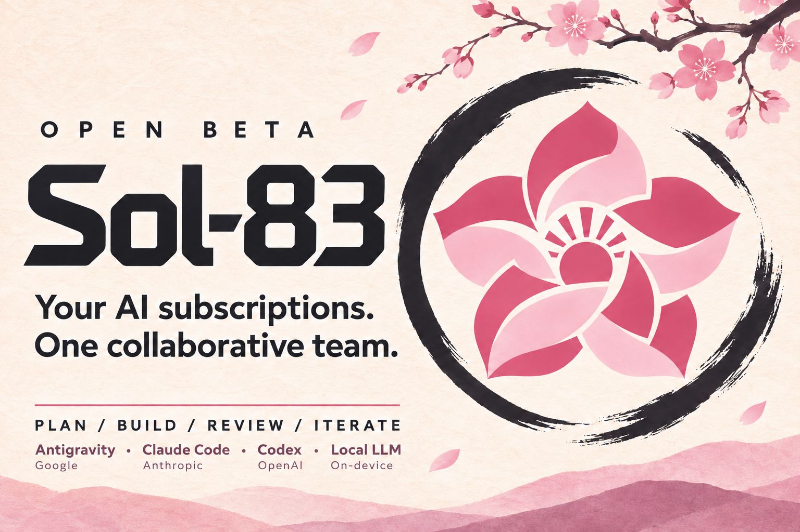
</p>

<p align="center">
  <b>Twoje abonamenty AI. Jeden zgrany zespół.</b><br>
  Claude Code · Codex · Gemini (Antigravity) · lokalny LLM
</p>

<p align="center">
  <a href="README.en.md">English</a> ·
  <a href="docs/pl/INSTALACJA.md">Instalacja</a> ·
  <a href="docs/pl/PRZEWODNIK.md">Przewodnik</a> ·
  <a href="#zrzuty-ekranu">Zrzuty ekranu</a> ·
  <a href="#kawa">Postaw mi kawę ☕</a>
</p>

# Sol-83 (OpenBeta)

### Myśl → notatka → projekt → gotowy efekt.

Sol-83 to Twoje biurko do pracy z AI. Zapisujesz pomysł jako notatkę, jednym kliknięciem zamieniasz ją w projekt, a **Claude Code, Codex i Gemini** pracują nad nim na zmianę: jeden wykonuje, drugi sprawdza. Ty dostajesz sprawdzone wersje, a pytania tylko wtedy, gdy decyzja naprawdę należy do Ciebie.

Wszystko na **abonamentach, które już masz**: bez kluczy API i bez płatnych dodatkowych kredytów. Sol-83 pilnuje limitów, oszczędza tokeny i przekazuje pracę modelowi, który ma jeszcze zapas.

> **Status:** OpenBeta, rozwijana od listopada 2026. Przetestowana na macOS (Apple Silicon). Linux jest obsługiwany w kodzie, ale nie był testowany na prawdziwej maszynie; Windows nie jest obsługiwany. Stan każdej funkcji, z testami i ograniczeniami: [docs/TRACEABILITY.md](docs/TRACEABILITY.md).

<a id="zrzuty-ekranu"></a>
<p align="center">
  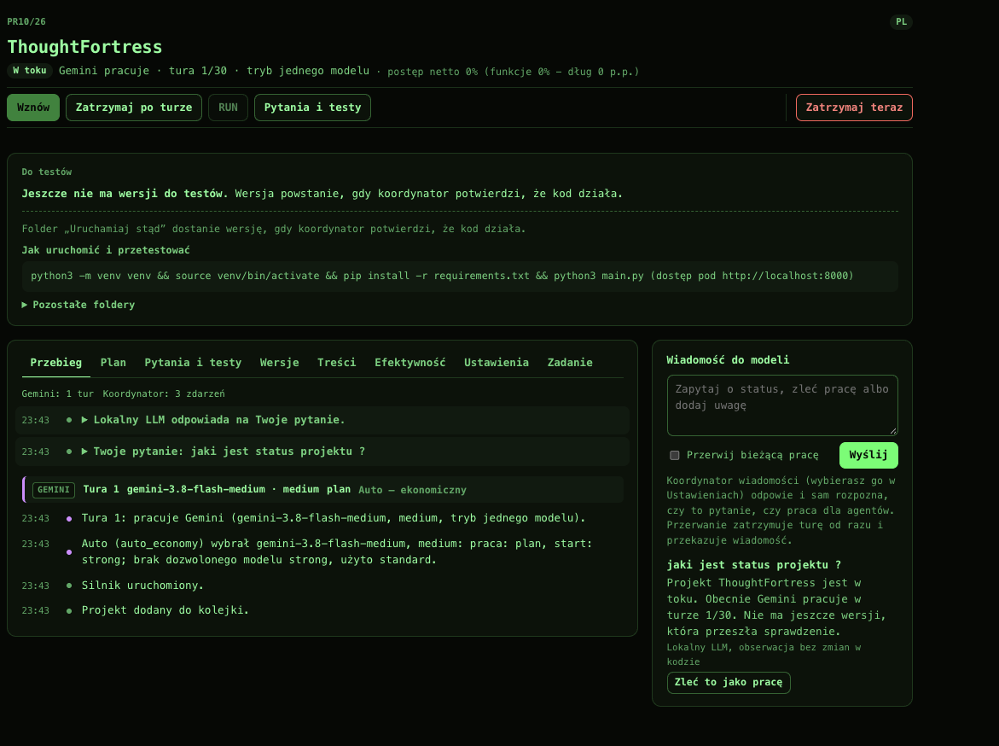<br>
  <sub>Canvas (paleta FOSFOR): aktywny projekt z oknami modeli, pod nim projekt wybrany ze stosu z sekcją RUN, po prawej stos projektów i notatki.</sub>
</p>

<table>
  <tr>
    <td width="50%" align="center" valign="top">
      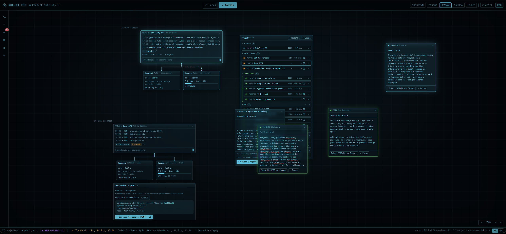<br>
      <sub>Ten sam Canvas w palecie CYJAN…</sub>
    </td>
    <td width="50%" align="center" valign="top">
      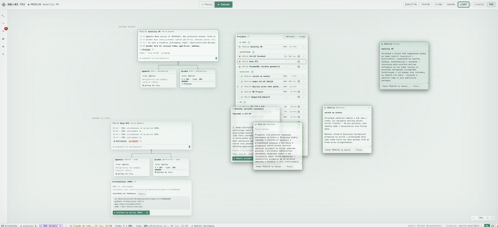<br>
      <sub>…i w jasnej palecie LIGHT.</sub>
    </td>
  </tr>
</table>

## W 30 sekund

- 📝 **Notatki zamiast promptów.** Piszesz, co chcesz osiągnąć, tak jak myślisz. Notatka z tytułem leży na Canvas, aż uznasz, że czas ją uruchomić.
- ▶️ **Jedno kliknięcie i jest projekt.** „Utwórz projekt” zakłada go z notatki, dobiera dostępne modele w trybie ekonomicznym i ustawia w kolejce. Notatka od tej chwili pokazuje numer projektu i jego stan.
- 🗺️ **Każdy projekt ma plan.** Modele rozpisują zadanie na funkcje i kroki z priorytetami, a Ty widzisz postęp w procentach i to, co jeszcze zostało.
- 🤝 **Zespół, nie jeden model.** Role przypisane modelom (architekt, implementujący, tester, twórca treści…) decydują, kto dostaje którą pracę. Sol-83 przed każdą turą sam wybiera wykonawcę.
- 💸 **Tokeny pod kontrolą.** Limity 5-godzinne i tygodniowe, przekazanie pracy po progu, tańszy model tam, gdzie wystarcza, krótki kontekst zamiast całej historii.
- 🐙 **GitHub w zestawie.** Pracuj na swoich repozytoriach albo publikuj gotowe wersje jako nowe repozytoria, ze skanem sekretów przed każdą wysyłką.
- 🧠 **Opcjonalnie lokalny model.** Model LLM na Twoim komputerze (np. przez Ollamę) przejmuje lekką koordynację i nie zużywa przy tym limitów abonamentów.

## Projektem może być wszystko

Sol-83 nie jest tylko „do kodu”. Jeśli coś da się opisać i sprawdzić, da się to zrobić jako projekt:

| Notatka | Co dostajesz |
|---|---|
| „Aplikacja do zarządzania portfelem walut: kursy, wykres, historia transakcji” | działającą aplikację z instrukcją uruchomienia i przyciskiem RUN |
| „Prosta gra przeglądarkowa w stylu tower defense” | grę, którą odpalasz jednym kliknięciem i testujesz |
| „Rozdział 3 powieści: bohaterka wraca do miasta po latach” | tekst rozdziału, sprawdzony przez drugi model pod kątem spójności i stylu |
| „Opracowanie naukowe o wpływie snu na pamięć, ze źródłami” | dokument z rozdziałami, bibliografią i oceną źródeł |
| „Research: porównanie trzech dostawców płatności dla sklepu” | raport z porównaniem, wnioskami i listą otwartych pytań |
| „Przeanalizuj umowę z kontrahentem” | listę ryzyk, niejasnych zapisów i pytań do negocjacji |
| „Przegląd kodu mojego repozytorium” | review z listą poprawek, a na życzenie same poprawki na osobnej gałęzi |
| „Przepis na sernik bez glutenu, na 12 porcji, z listą zakupów” | przepis, proporcje i listę zakupów |
| „Nowa wersja mojego arkusza Excel z budżetem domowym” | arkusz z nowymi formułami i opisem zmian |

Przy dokumentach i researchu Sol-83 nie buduje zaplecza programistycznego (testów, skryptów). Modele sprawdzają treść i źródła, więc nie zużywasz tokenów na rzeczy, których projekt nie potrzebuje.

<p align="center"><b>Zbudowane w Sol-83</b></p>

<table>
  <tr>
    <td width="33%" align="center" valign="top">
      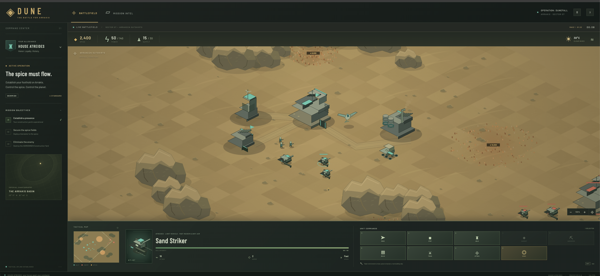<br>
      <sub>Gra strategiczna czasu rzeczywistego, uruchamiana przyciskiem RUN.</sub>
    </td>
    <td width="33%" align="center" valign="top">
      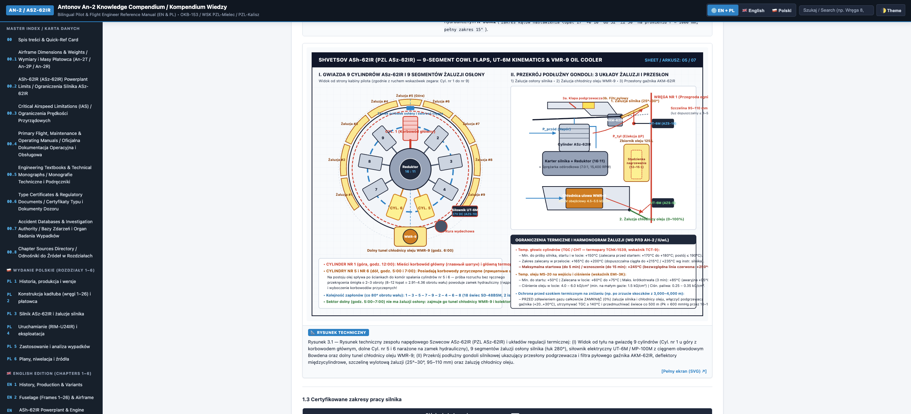<br>
      <sub>Dwujęzyczne (PL/EN) kompendium techniczne z rysunkami i źródłami.</sub>
    </td>
    <td width="33%" align="center" valign="top">
      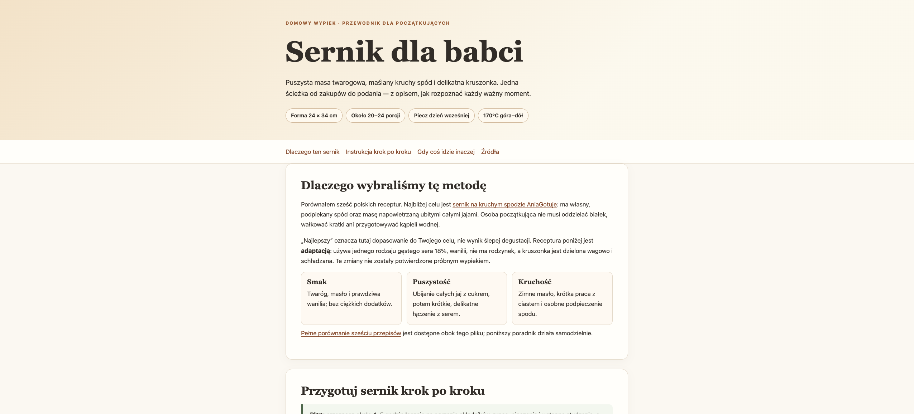<br>
      <sub>Przepis na sernik jako strona: krok po kroku, z uzasadnieniem i źródłami.</sub>
    </td>
  </tr>
</table>

## Canvas: Twoja przestrzeń do myślenia i działania

Wygląd **Pro** (domyślny) to Canvas: tablica, którą przesuwasz i powiększasz jak mapę, a w niej wszystko, nad czym pracujesz.

- **Notatki** to stałe bloki z tytułem i przewijanym tekstem. Zapisują się same. Pod tekstem widać, jakie modele dostanie projekt, zanim go utworzysz. Po utworzeniu notatka świeci w kolorze stanu projektu: przerywana ramka w kolejce, jasna przy pracy, pomarańczowa po zatrzymaniu, zielona po ukończeniu.
- **Aktywny projekt** to ten, nad którym ktoś teraz pracuje. Widzisz go razem z oknami modeli, połączonymi liniami (linia do modelu, który pracuje, jest animowana).
- **Projekt wybrany ze stosu** ląduje pod aktywnym, z sekcją „Uruchomienie”: gdzie leży gotowa wersja, polecenia do terminala i przycisk RUN.
- **Stos projektów** to wszystkie projekty jako zwinięte belki: numer, nazwa, postęp, zużyte tokeny („2,3 mln”), ikona GitHuba i lampka stanu, która świeci, a nie mruga. Kolejkę ustawiasz przeciąganiem, projekty grupujesz we własne foldery („Analizy”, „Gry”, „Praca”), a zakończone chowasz do archiwum.
- **RUN pod kontrolą.** Projekty z działającą aplikacją mają migającą plakietkę ▶ RUN, a pasek stanu mówi, ile aplikacji działa. Nic nie zostaje uruchomione „po cichu”.
- **Powiadomienia.** Pytania i prośby o test pojawiają się w rogu ekranu z przyciskami odpowiedzi, a na życzenie także jako powiadomienie systemowe, które zostaje, dopóki go nie zamkniesz.

<p align="center">
  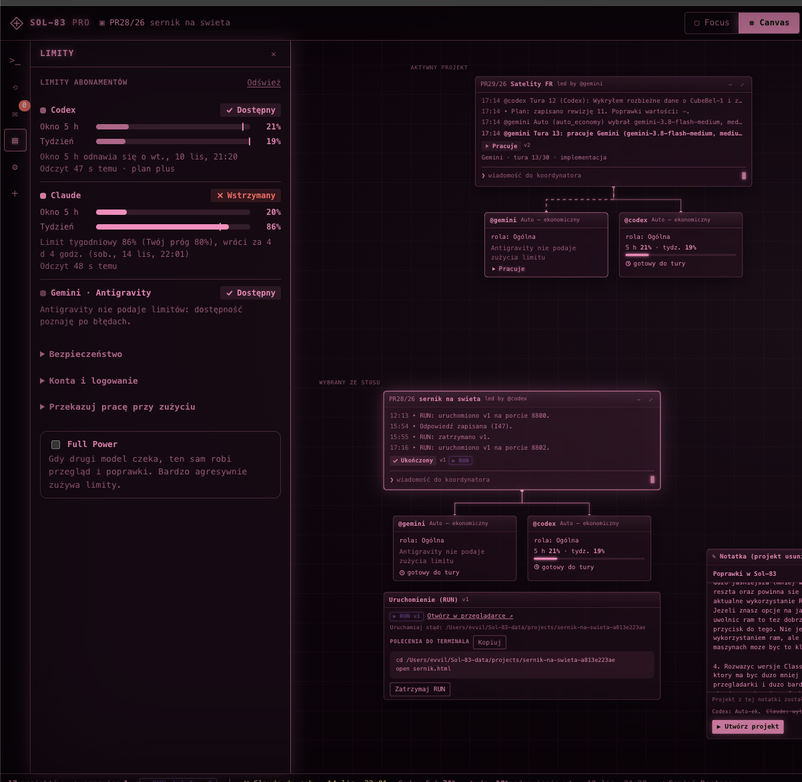<br>
  <sub>Paleta SAKURA z bliska: limity abonamentów, aktywny projekt, projekt ze stosu z działającym RUN i notatka gotowa do zamiany w projekt.</sub>
</p>

Widok **Focus** pokazuje jeden projekt ze wszystkimi szczegółami: przebieg tur, plan, pytania i testy, wersje, treści, efektywność, ustawienia, zadanie. Wolisz prostszy panel? Przycisk **CLASSIC** przełącza na klasyczny wygląd z tymi samymi funkcjami.

## Plan dla każdego projektu

Projekt nie jest jednym długim promptem. Na początku model w roli architekta rozpisuje go na plan:

- **funkcje i kroki** z priorytetem (musi / powinno / może) i budżetem tur,
- **postęp netto**: ile funkcji jest gotowych, minus dług (rzeczy zrobione „na skróty”, które trzeba poprawić),
- **bramki odbioru**: projekt nie zamknie się z otwartym obowiązkowym pytaniem, testem albo odłożonym „musi”,
- **gdzie poszedł limit**: ile tygodniowego limitu zjadł każdy krok.

Plan żyje razem z projektem: modele aktualizują status kroków, a Ty możesz w każdej chwili zlecić wybrany krok przyciskiem „Zleć”.

<p align="center">
  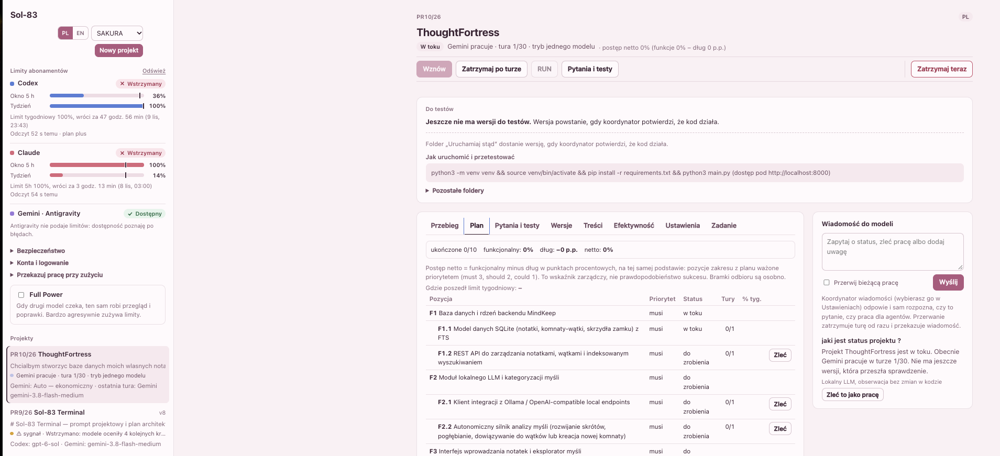<br>
  <sub>Plan w widoku Focus: funkcje i kroki z priorytetem, statusem, liczbą tur i kosztem limitu.</sub>
</p>

## W trakcie projektu Ty trzymasz ster

Projekt nie musi iść „od A do Z” bez Twojego udziału. W każdej chwili możesz go poprawić:

- **❯ wiadomość do koordynatora**: zapytaj o stan („co już działa?”) albo wydaj polecenie („dodaj tryb ciemny”). Koordynator sam rozpozna, czy to pytanie, czy praca dla modeli. Pilną zmianę możesz zlecić z przerwaniem bieżącej tury.
- **Zmiana zespołu w locie**: inny model, poziom myślenia, role albo tryb Auto. Obowiązuje od następnej tury, bieżąca kończy pracę po staremu.
- **„Nie działa” przy wersji** z komentarzem wraca do modeli jako konkretna poprawka.
- **Zatrzymaj, wznów, uruchom jako następny** albo zmień kolejność w kolejce przeciąganiem.
- **Pytania i testy dla Ciebie** pojawiają się tylko wtedy, gdy są potrzebne: decyzje z gotowymi odpowiedziami do kliknięcia, a test ręczny domyślnie tylko przy wersji końcowej.

## Zespół modeli: role przydzielane według potrzeb

Każdemu modelowi nadajesz role (może mieć kilka naraz):

| Rola | Co robi |
|---|---|
| **Ogólna** | wszystko: plan, implementację i przegląd |
| **Architekt** | plan, przebudowę planu i research |
| **Implementujący** | kolejne kroki z planu |
| **Tester** | przegląd zmian i testy |
| **Analityk systemowy** | szuka luk i planuje ich naprawę jako dług |
| **Twórca treści** | zamówione grafiki, teksty i fabułę (po Twojej akceptacji) |

Przed każdą turą koordynator sprawdza, jakiej pracy teraz potrzeba (plan, implementacja, przegląd, treści), i daje ją modelowi z pasującą rolą, który ma zapas limitu. Gdy model z rolą jest niedostępny, pracę przejmuje model z rolą Ogólną (albo projekt czeka, jeśli tak wolisz). Przykład: Claude jako architekt i tester, Codex jako implementujący, Gemini jako twórca treści. Każdy robi to, w czym jest najlepszy, i nikt nie sprawdza sam siebie.

**Tryb wyboru modelu**, osobno dla każdego dostawcy:
- **Ręczny**: dokładnie ten model, który wskażesz,
- **Auto — ekonomiczny**: najtańszy model, który wystarczy do danej pracy, a mocniejszy dopiero po kolejnych niepowodzeniach,
- **Auto — power**: mocniejszy model z dozwolonej puli, nadal z kontrolą limitów.

Najdroższe modele dostawcy nigdy nie są wybierane automatycznie; ręcznie tylko z Twoim potwierdzeniem. Każda decyzja Auto trafia do historii projektu razem z powodem.

<p align="center">
  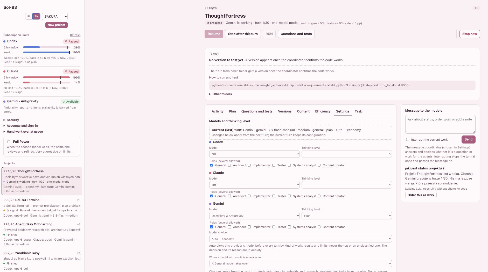<br>
  <sub>Ustawienia projektu: model, poziom myślenia, role i tryb Auto dla każdego dostawcy oraz migawka bieżącej tury.</sub>
</p>

## Tokeny i limity: zarządzanie, nie loteria

Abonamenty mają limity (okno 5-godzinne i tygodniowe). Sol-83 traktuje je jak budżet:

- **Odczyt limitów na bieżąco.** Panel pokazuje zużycie Claude i Codex, daty odnowienia okien i przerwy Gemini. Czekanie na limit nie kosztuje ani jednego tokenu.
- **Przekazanie po progu.** Ustawiasz próg (np. 95% okna 5 h, 80% tygodnia). Gdy model go osiągnie, pracę przejmuje drugi, a pierwszy wraca po odnowieniu.
- **Krótki kontekst zamiast całej historii.** Każda tura zaczyna nową sesję z zwartym pakietem przekazania: zadanie, plan i zmiany od ostatniej tury tego modelu (do 4000 znaków). Agent nie czyta w kółko wszystkiego od początku.
- **Przegląd z głową.** Drugi model sprawdza pracę po zamknięciu etapu planu, przy dużej zmianie (od 500 linii), przy zgłoszeniu gotowości albo najpóźniej co 3 tury, a nie po każdej. Dostaje diff zmian (do 30 000 znaków), a nie całe pliki.
- **Oszczędna praca w instrukcjach.** Modele zapisują plik w całości zamiast wielu drobnych edycji, uruchamiają testy raz na koniec tury i skracają wyjście poleceń.
- **Bez płatnych niespodzianek.** Antigravity (Gemini) zawsze bez płatnych kredytów, z limitem czasu tury; domyślnie szybki i tani Gemini Flash.
- **Wszystko policzone.** Zakładka Efektywność pokazuje tokeny według modelu i tury oraz ile każdego okna limitu zużył projekt. Na stosie widzisz sumę tokenów każdego projektu.

**Full Power** to opcja dla niecierpliwych: gdy drugi model czeka na reset, ten sam robi przegląd w nowej sesji, zamiast czekać. Działa szybciej, ale szybciej też zużywa limity, dlatego jest wyłączona domyślnie.

## Lokalny model jako wzmocnienie

Sol-83 działa bez lokalnego modelu, ale jeśli masz **Ollamę** (np. z modelem Gemma), możesz z niej skorzystać jako z koordynatora wiadomości:

- odpowiada na pytania o stan projektu, nie zużywając limitów abonamentów,
- rozpoznaje, czy Twoja wiadomość to pytanie, czy zlecenie pracy dla modeli,
- przygotowuje gotowe polecenia do terminala, żeby uruchomić wersję.

Możesz wybrać innego koordynatora (Claude, Codex, Gemini) albo żadnego. Gdy wybrany nie może odpowiedzieć, zastępuje go lokalny model.

## Integracja z GitHubem

- **Zacznij od swojego repozytorium.** Panel pokazuje Twoje repozytoria z GitHuba; kliknięcie otwiera nowy projekt na wybranym.
- **Albo od istniejącego folderu.** Modele pracują na osobnej gałęzi w osobnym folderze roboczym. Twoja gałąź główna zostaje nietknięta.
- **Dostarczanie po Twojemu**: tylko lokalnie, push gałęzi albo push z pull requestem, z osobnymi zgodami na push i PR. Bez force push, bez przepisywania historii.
- **Publikacja gotowej wersji** jako nowe repozytorium prywatne albo publiczne, a nowe wersje mogą trafiać tam same (dla prywatnych).
- **Skan sekretów przed każdą wysyłką**, także prywatną. Klucz API w kodzie nie wyjdzie bez Twojego wyraźnego potwierdzenia.
- Ikona GitHuba na belce projektu otwiera repozytorium w nowej karcie.

## Ty decydujesz, Sol-83 pilnuje

- **Wersja dostaje numer dopiero po testach** w piaskownicy systemu: kod z repozytorium może zapisywać tylko w folderze projektu i domyślnie nie ma dostępu do sieci.
- **Nic nie wychodzi bez Twojej decyzji**: ani na GitHub, ani nigdzie indziej.
- **Panel działa tylko lokalnie** (`127.0.0.1`) i jest chroniony przed żądaniami z innych stron.
- **Trwała kolejka zleceń**: nic nie ginie przy restarcie, podwójnym kliknięciu ani zamknięciu projektu.
- **Język projektu (PL albo EN)** jest stały we wszystkich instrukcjach dla modeli; interfejs przełączasz niezależnie.

## Dla kogo

Dla każdego, kto ma **co najmniej dwa abonamenty AI** (np. Claude i ChatGPT/Codex, opcjonalnie Gemini) i chce, żeby wreszcie pracowały razem: dla programistów, dla osób, które „vibe codują”, i dla tych, którzy w ogóle nie piszą kodu, a mają pomysł na tekst, analizę albo research. Nie musisz znać Gita ani konfigurować modeli: zaczynasz od notatki, resztę Sol-83 ustawia sam, a Ty możesz to zmienić, kiedy zechcesz.

## Szybki start

Pełna instalacja od zera, krok po kroku: **[docs/pl/INSTALACJA.md](docs/pl/INSTALACJA.md)**.

```bash
git clone https://github.com/MikeMcqueen83/Sol-83-OpenBeta.git
```

```bash
cd Sol-83-OpenBeta && ./bin/setup && ./sol83 doctor
```

```bash
./sol83 serve
```

Potem otwórz http://127.0.0.1:8765, kliknij **+ Notatka** w stosie projektów, opisz pomysł i kliknij **▶ Utwórz projekt**.

<p align="center">
  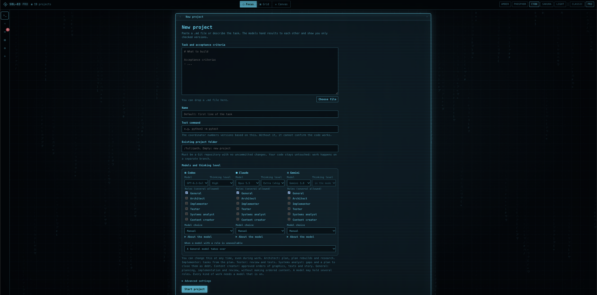<br>
  <sub>Wolisz klasycznie? Projekt założysz też z formularza: zadanie, folder, modele, poziom myślenia i role.</sub>
</p>

## Dokumentacja

| Temat | PL | EN |
|---|---|---|
| Instalacja od zera | [INSTALACJA](docs/pl/INSTALACJA.md) | [INSTALL](docs/en/INSTALL.md) |
| Przewodnik: notatki i Canvas, projekty, plan, modele i role, Auto, limity i tokeny, wersje i RUN, pytania, treści, język, Git i GitHub, licencje, wygląd Classic i Pro | [PRZEWODNIK](docs/pl/PRZEWODNIK.md) | [GUIDE](docs/en/GUIDE.md) |
| Dane, kopie, aktualizacje, migracje, powrót | [AKTUALIZACJE](docs/pl/AKTUALIZACJE.md) | [UPDATES](docs/en/UPDATES.md) |
| Bezpieczeństwo | [SECURITY.md](SECURITY.md) | [SECURITY.md](SECURITY.md) |
| Współpraca | [CONTRIBUTING.md](CONTRIBUTING.md) | [CONTRIBUTING.md](CONTRIBUTING.md) |
| Wymagania i stan wdrożenia | [TRACEABILITY](docs/TRACEABILITY.md) | |
| Zmiany | [CHANGELOG.md](CHANGELOG.md) | [CHANGELOG.md](CHANGELOG.md) |

<a id="kawa"></a>
## ☕ Postaw mi kawę

Sol-83 rozwijam samodzielnie i udostępniam bezpłatnie do użytku niekomercyjnego. Jeśli oszczędził Ci czas albo limity abonamentów, jeśli podoba Ci się sam pomysł, albo po prostu chcesz, żeby kolejne funkcje pojawiały się szybciej, postaw mi kawę. To realnie pomaga w dalszym rozwoju, a każde wsparcie bardzo motywuje. Dziękuję! 🌸

<p align="center">
  <a href="https://buycoffee.to/evvil" target="_blank"></a>
</p>

## Licencja

Sol-83 jest udostępniany jako **source-available**, a nie jako open source w rozumieniu OSI. Użycie niekomercyjne przez osoby prywatne jest dozwolone. Użycie komercyjne, w tym przez firmy (także wewnętrzne) oraz włączanie kodu lub jego części do monetyzowanych produktów i usług, wymaga uprzedniej pisemnej zgody autora. Zmiany wnosi się przez fork lub gałąź. Warunki są projektem do weryfikacji prawnej: [LICENSE.md](LICENSE.md). Silnik Duet i inne komponenty zachowują swoje licencje: [THIRD_PARTY_NOTICES.md](THIRD_PARTY_NOTICES.md). Licencja projektów, które tworzysz w Sol-83, jest Twoim wyborem i nie zależy od licencji Sol-83.

Autor: Michał Werpachowski.
